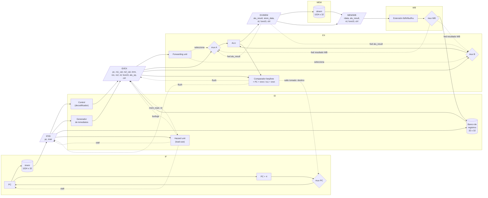

# Arquitectura del datapath

Pipeline de 5 etapas (IF, ID, EX, MEM, WB) con forwarding, detección de riesgo load-use y flush de saltos. Los anchos y campos de los latches están en [`interfaz_core.md`](interfaz_core.md), sección 3.

## Resumen de las unidades de control

| Unidad | Entradas | Salidas | Regla |
|---|---|---|---|
| Forwarding | `rs1`, `rs2` de ID/EX; `rd` y `reg_write` de EX/MEM y MEM/WB | selectores de mux A y B (y de `store_data`) | Prioridad a EX/MEM sobre MEM/WB; nunca se forwardea `x0`. |
| Hazard (load-use) | `mem_read` y `rd` de ID/EX; `rs1`, `rs2` de la instrucción en ID | stall de PC e IF/ID, burbuja en ID/EX | Si la instrucción en EX es un load y su `rd` coincide con un operando de la que está en ID: 1 ciclo de stall. |
| Saltos | `branch`, `jal`, `jalr`, comparación en EX | `PC <- destino`, flush de IF/ID e ID/EX | Se resuelve en EX (D5): 2 instrucciones descartadas por salto tomado. |
| HALT | `ebreak` o ilegal en ID (no descartado) | `halted`/`illegal`, PC congelado | Las instrucciones anteriores terminan de drenar; `pipeline_empty` marca el final. |

El banco de registros resuelve internamente el caso escritura-lectura del mismo registro en el mismo ciclo (D6), por lo que no hace falta forwarding desde WB hacia ID.

## Control desde la Debug Unit

`ce` habilita PC, los cuatro latches, el banco de registros y las escrituras de la dmem; no hay ningún otro clock en el core (D1). Las lecturas de debug (`dbg_reg_*`, `dbg_dmem_*`) usan puertos aparte y la escritura de la imem entra por su propio puerto, ambos independientes de `ce`.
