# Decisiones de diseño

Registro de decisiones del TP3. Cada quien anota sus decisiones al tomarlas, con el número reservado en la issue correspondiente.

Plantilla:

```markdown
## Dn - Título

- **Contexto:** qué problema hay que resolver.
- **Opciones:** alternativas consideradas.
- **Elección:** qué se decidió.
- **Por qué:** justificación (números si los hay).
- **Issue:** #N
```

---

## D9 - Baud rate de la UART: 115200

- **Contexto:** TP2 usaba 19200 baudios. En TP3 la UART carga programas de hasta 1024 palabras (4 KB) y transmite volcados de ~200 B en cada STEP.
- **Opciones:** 19200 (como TP2), 115200, velocidades mayores (230400 o más).
- **Elección:** 115200, 8N1, parametrizado con `CLK_FREQ` y `BAUD` (`DVSR = CLK_FREQ / (16·BAUD)`).
- **Por qué:** cargar 4 KB tarda ≈ 2,1 s a 19200 y ≈ 0,36 s a 115200; un volcado pasa de ≈ 100 ms a ≈ 17 ms. A 100 MHz, DVSR = 54 con error de 0,47 %, muy por debajo de la tolerancia de 8N1. Es una velocidad estándar que soportan el FT2232 de la Basys 3 y pyserial. Al estar parametrizado, si cambia la frecuencia del clock (TIME-3) el divisor se recalcula solo.
- **Issue:** #2, #12

## D10 - LOAD hace reset completo del core

- **Contexto:** al cargar un programa nuevo puede quedar estado del anterior (registros, dmem, latches, instrucciones viejas en imem si el programa nuevo es más corto).
- **Opciones:** (a) LOAD solo escribe la imem; (b) LOAD hace reset completo y rellena con ceros el resto de imem.
- **Elección:** (b). Antes de escribir: PC=0, flush del pipeline, registros y dmem a 0; después de los datos, el resto de la imem queda en cero.
- **Por qué:** ejecuciones reproducibles: el resultado de un programa no depende de lo que se haya corrido antes. El relleno con ceros hace que un programa sin HALT termine en una instrucción ilegal (0x00000000) en lugar de ejecutar código viejo.
- **Issue:** #2, #14

## D12 - Comandos recibidos durante RUN

- **Contexto:** mientras el core corre en modo continuo puede llegar cualquier byte por la UART.
- **Opciones:** (a) atender todos los comandos; (b) responder NACK BUSY a todo menos STOP; (c) atender solo STOP y descartar el resto.
- **Elección:** (c). RUN termina siempre con un único DUMP, ya sea por HALT o por STOP.
- **Por qué:** es la opción más simple en hardware y evita interpretar a medias tramas con argumentos (por ejemplo, los datos de un LOAD contienen bytes que coinciden con códigos de comando). La librería del PC no permite enviar otros comandos durante RUN, así que el descarte no pierde información útil. Detalle en `protocolo_uart.md`, sección 5.
- **Issue:** #2

## D13 - Receptor UART: errores de trama, overrun y detección del start

- **Contexto:** la UART de TP2 no verificaba el bit de stop y descartaba en silencio los bytes que llegaban con la FIFO de recepción llena. El protocolo (`protocolo_uart.md`) necesita detectar ambos casos para responder NACK `0x05`.
- **Opciones:** (a) guardar el byte con error y marcarlo; (b) descartarlo y levantar un flag; para el start, detectar por nivel (TP2) o por flanco.
- **Elección:** (b), con flags sticky `frame_err` y `rx_overrun` que la Debug Unit limpia con `clr_err`. El start se detecta por flanco de bajada y se vuelve a verificar en el medio del bit (si la línea volvió a 1 era un glitch). El sincronizador de `rx` pasa a estar adentro de `uart.v`.
- **Por qué:** un byte con error no sirve para nada en el protocolo: la trama entera se descarta. Por nivel, después de un error de trama la línea sigue en 0 hasta el final del stop y el receptor lo tomaba como un start nuevo y quedaba desincronizado (lo detectó `uart_tb`). Con el sincronizador adentro, cualquier top que use la UART queda protegido contra metaestabilidad.
- **Issue:** #12
## D2 - NOP y HALT

- **Contexto:** hace falta una instrucción que no haga nada (burbujas, relleno) y una forma de detener el core.
- **Opciones:** NOP como `addi x0,x0,0` u otra codificación; HALT como `ebreak`, un `jal` a sí mismo o un opcode propio.
- **Elección:** NOP = `addi x0, x0, 0` (`0x00000013`); HALT = `ebreak` (`0x00100073`).
- **Por qué:** ambas son las codificaciones canónicas de RISC-V, así que cualquier ensamblador estándar las produce y no inventamos un opcode propio. `ebreak` es una instrucción real de la ISA, distinta de las 32 del set, y se decodifica comparando la palabra completa.
- **Issue:** #1

## D3 - Instrucción ilegal = HALT con flag `illegal`

- **Contexto:** qué pasa si el programa no tiene instrucción de parada, o si el PC cae en memoria sin programa.
- **Opciones:** (a) ignorar la instrucción y seguir; (b) tratarla como NOP; (c) detener el core y avisar.
- **Elección:** (c). Toda palabra que no decodifica a una de las 32 instrucciones (ni `ebreak`), incluida `0x00000000`, se trata como HALT y levanta el flag `illegal`, que se informa en el DUMP.
- **Por qué:** con (a) o (b) un programa sin HALT correría hasta recorrer toda la imem. Como LOAD rellena el resto de imem con ceros (D10), un programa sin parada termina siempre en `0x00000000`, se detiene y el flag distingue "terminó por ebreak" de "se cayó fuera del programa".
- **Issue:** #1

## D4 - Direccionamiento de memoria y PC

- **Contexto:** unidad de direccionamiento y alineación de instrucciones y datos.
- **Opciones:** memoria direccionada por palabra o por byte.
- **Elección:** memoria direccionada por byte; instrucciones de 32 bits alineadas a 4; el PC avanza de a 4. Lecturas y escrituras de `lh/lhu/sh` y `lw/sw` se asumen alineadas (a 2 y 4); el comportamiento ante desalineación no está especificado.
- **Por qué:** es el modelo de RV32I, y `lb/lbu/sb` obligan a acceder por byte. Usar la misma convención que el ensamblador evita conversiones de offsets en `beq`/`bne`/`jal`.
- **Issue:** #1

## D1 - El clock no se toca: el core se controla solo con `ce`

- **Contexto:** para STEP y RUN hay que poder detener y avanzar el core desde la Debug Unit.
- **Opciones:** (a) compuertar o dividir el clock del core; (b) un clock enable global (`ce`) sobre un único clock.
- **Elección:** (b). `clk` llega sin modificar a todo el diseño; `ce` habilita PC, latches, banco de registros y escrituras de dmem. STEP es un pulso de `ce` de un ciclo; RUN mantiene `ce=1`.
- **Por qué:** compuertar el clock genera dominios de reloj extra, skew y problemas de timing en la implementación (además de que complica el análisis de TIME-2). Con `ce` el análisis de timing sigue siendo el de un solo clock y las BRAM usan su enable nativo.
- **Issue:** #3, #13

### Diagrama de estados de la Debug Unit (DBG-2)

`src/debug_unit.v` es una FSM one-hot. `ce` solo vale 1 en `STEP` (un ciclo) y en `RUN`; `core_reset` solo en `RST`. Ninguno de los dos sube mientras el core tiene `reset_busy`.

```mermaid
stateDiagram-v2
    [*] --> IDLE
    IDLE --> TX_PREP: PING, STOP / ACK; desconocido / NACK 0x01
    IDLE --> ARGS: LOAD, READ_DMEM
    IDLE --> RST: RESET
    IDLE --> STEP: STEP
    IDLE --> RUN: RUN
    IDLE --> HOLD: DUMP
    IDLE --> DRAIN: error de UART (NACK 0x05)
    ARGS --> ARGS: byte de argumento
    ARGS --> TX_PREP: timeout / NACK 0x02
    ARGS --> DRAIN: BAD_ARG, UART_ERR
    DRAIN --> DRAIN: byte recibido (se descarta)
    DRAIN --> TX_PREP: 10 ms sin bytes / NACK
    RST --> RST_WAIT: core_reset = 1
    RST_WAIT --> TX_PREP: !reset_busy / ACK
    STEP --> HOLD: !reset_busy, ce = 1 un ciclo
    RUN --> HOLD: halted && pipeline_empty, o STOP
    HOLD --> SNAP: ce = 0 un ciclo
    SNAP --> TX_PREP: copia PC, status y latches
    TX_PREP --> TX_WR
    TX_WR --> TX_PREP: !tx_full, quedan bytes
    TX_WR --> IDLE: ultimo byte
```



`TX_PREP` + `TX_WR` mandan un byte cada dos ciclos (como mínimo): el primero es la espera de la latencia de 1 ciclo de `dbg_reg_*`/`dbg_dmem_*` (D8). La UART es miles de veces más lenta, así que no cuesta nada. El vector `fsm_state` sale del módulo para los LEDs de la placa.

## D8 - Interfaz Debug Unit <-> Core

- **Contexto:** la Debug Unit necesita cargar la imem, controlar el avance y leer el estado completo del core.
- **Opciones:** (a) un bus de lectura genérico con direcciones; (b) buses planos con PC y latches más puertos de dirección para registros y dmem.
- **Elección:** (b). Detalle completo en [`interfaz_core.md`](interfaz_core.md). Puntos no obvios:
  - El volcado se hace solo con `ce=0` y desde un snapshot de PC y latches tomado un ciclo después de bajar `ce`.
  - Cada latch lleva un bit de `valid`, que viaja en el `status` del DUMP; una burbuja es `valid=0` con contenido en cero.
  - `reset_busy`: limpiar la dmem lleva hasta 1024 ciclos (una BRAM no se resetea de golpe), así que `core_reset` no es instantáneo y la Debug Unit espera.
  - Latencia fija de 1 ciclo en `dbg_reg_*` y `dbg_dmem_*`, aunque el banco de registros sea combinacional, para que la Debug Unit no dependa de la implementación.
  - Los latches se dumpean tal como están en el hardware: `rdata` en MEM/WB sin extender, `alu_op` como `{funct7[5], funct3}`.
- **Por qué:** los buses planos hacen que el volcado no necesite lógica de lectura en el core ni sepa de pipelines, y los anchos fijos dan un payload de 181 B (≈ 16 ms a 115200). Dumpear los latches sin transformar mantiene el core simple y deja la interpretación al software de PC.
- **Issue:** #3

## D11 - `dmem_hwm` y volcado del rango usado

- **Contexto:** la dmem tiene 4 KB; volcarla entera en cada STEP costaría ≈ 0,36 s a 115200.
- **Opciones:** (a) volcar toda la dmem; (b) que el PC pida el rango; (c) llevar la mayor dirección escrita y volcar solo hasta ahí.
- **Elección:** (c) más (b): el core expone `dmem_hwm` (13 bits) = **mayor dirección de byte escrita + 1** (0 = vacía); se reinicia con `core_reset`. READ_DMEM con `count = 0` devuelve `ceil(dmem_hwm / 4)` palabras desde `addr`. El DUMP no incluye la dmem.
- **Por qué:** guardar "dirección + 1" evita un bit extra para distinguir "vacía" de "se escribió la dirección 0", y los programas típicos usan pocos bytes de dmem. Sacar la dmem del DUMP mantiene el volcado en 181 B fijos.
- **Issue:** #3, #27

## D14 - Errores a mitad de trama: descartar hasta silencio y después NACK

- **Contexto:** los comandos no llevan SOF ni largo total (SPEC-2). Si una trama falla a mitad de camino (por ejemplo, LOAD con `len` fuera de rango o un error de trama en la UART), el resto de sus bytes sigue llegando; si la FSM vuelve a IDLE enseguida, los interpreta como comandos y responde basura (los datos de un LOAD contienen bytes `0x01`..`0x08`).
- **Opciones:** (a) NACK inmediato y volver a IDLE; (b) NACK inmediato y descartar lo que llegue después; (c) descartar todo lo que llegue hasta que la línea quede 10 ms en silencio (el mismo timeout de trama) y recién ahí responder el NACK.
- **Elección:** (c), para BAD_ARG y UART_ERR. Un error de UART en IDLE (no hay comando válido) se informa como NACK con `cmd = 0x00`. TIMEOUT ya llega con la línea en silencio y se responde enseguida; UNKNOWN_CMD es una trama de un byte y también.
- **Por qué:** con (a) un LOAD rechazado generaría decenas de respuestas espurias. Con (b) el PC recibe el NACK mientras sigue enviando y podría mandar el comando siguiente antes de que la FSM termine de descartar. Con (c) el NACK llega cuando la FPGA ya está en IDLE y limpia, así que el PC puede reintentar enseguida. Cuesta 10 ms de latencia en un caso de error, que es irrelevante. Durante el descarte se mantiene `clr_err` para que los errores de esos bytes no generen un segundo NACK.
- **Issue:** #13
