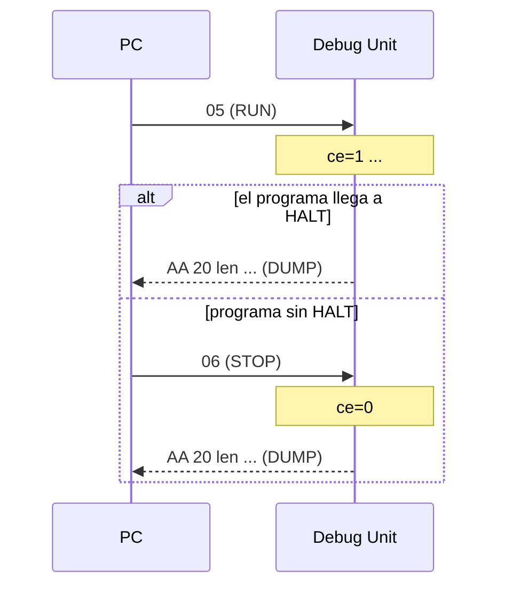
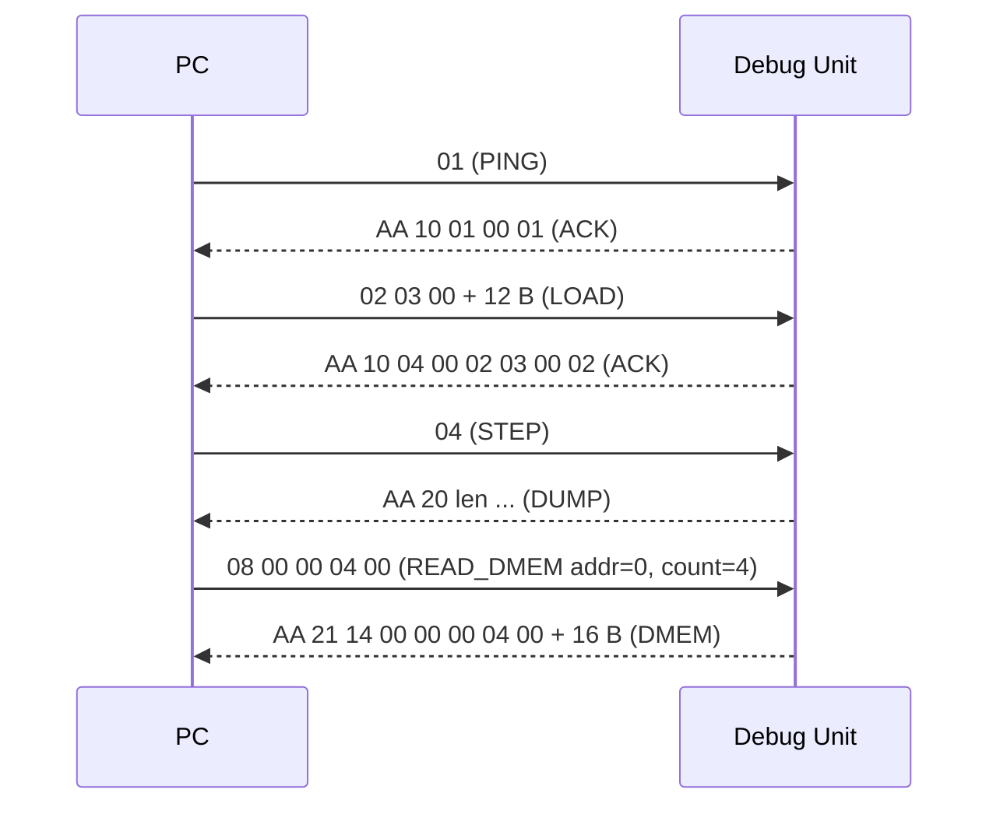
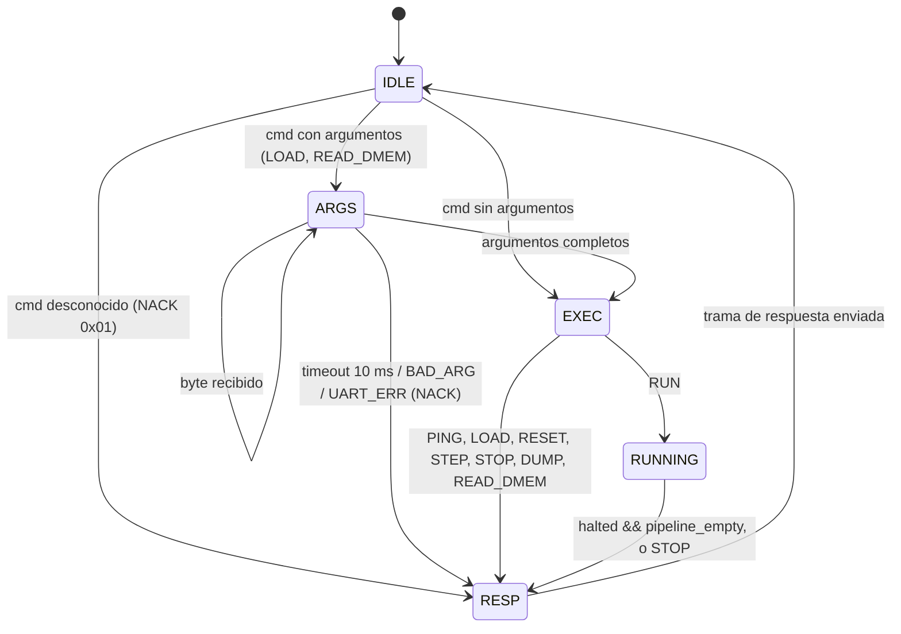

# Protocolo UART: PC <-> Debug Unit

Contrato entre la Debug Unit (RTL, `TP3/src/debug_unit.v`) y el software de PC (`TP3/sw/`). Cualquier cambio en este documento se hace por PR y con revisión de ambos integrantes, porque afecta al RTL y al software a la vez.

Issues relacionadas: SPEC-2 (#2, este documento), SPEC-3 (#3, formato del volcado), DBG-1 (#12, UART), DBG-2 (#13, FSM), DBG-3 (#14, loader), SW-2 (#17, cliente serie).

---

## 1. Capa física

| Parámetro | Valor |
|---|---|
| Formato | 8N1 (8 bits de datos, sin paridad, 1 bit de stop) |
| Baud rate | 115200 (decisión D9) |
| Sobremuestreo | x16 (igual que la UART de TP2) |
| Divisor | `DVSR = CLK_FREQ / (16 * BAUD)` → 54 a 100 MHz (error 0,47 %) |
| Tiempo por byte | 10 bits / 115200 ≈ 86,8 µs |
| Orden de bytes | **little-endian** en todo campo de más de un byte |

El divisor se calcula en el RTL a partir de los parámetros `CLK_FREQ` y `BAUD`, de modo que si cambia el clock (TIME-3) no hay que recalcularlo a mano.

---

## 2. Tramas PC → FPGA (comandos)

Formato: `[cmd 1 B][argumentos]`. No hay byte de inicio: el primer byte recibido en estado IDLE es siempre un comando.

| Byte | Comando | Argumentos | Efecto | Respuesta | Válido en |
|---|---|---|---|---|---|
| `0x01` | PING | – | Verifica el enlace | ACK | IDLE |
| `0x02` | LOAD | `len` (2 B, en palabras) + `len·4` B de datos | Reset completo (D10) y escritura de la memoria de programa desde la dirección 0; el resto de imem queda en cero | ACK (con conteo y XOR) / NACK | IDLE |
| `0x03` | RESET | – | PC=0, flush del pipeline, registros y dmem a 0. No toca la imem | ACK | IDLE |
| `0x04` | STEP | – | `ce=1` durante exactamente un ciclo | DUMP | IDLE |
| `0x05` | RUN | – | `ce=1` hasta `halted && pipeline_empty` | DUMP (al terminar) | IDLE |
| `0x06` | STOP | – | Baja `ce` inmediatamente (programas sin HALT) | DUMP si estaba en RUN; ACK si no | IDLE, RUNNING |
| `0x07` | DUMP | – | Volcado bajo demanda | DUMP | IDLE |
| `0x08` | READ_DMEM | `addr` (2 B) + `count` (2 B) | Lee un rango de la memoria de datos | DMEM / NACK | IDLE |

### Detalle de argumentos

- **LOAD**
  - `len`: cantidad de palabras de 32 bits, `1 ≤ len ≤ 1024` (tamaño de la imem). `len = 0` o `len > 1024` → NACK `0x03` (sin consumir datos).
  - Datos: `len` palabras, cada una en little-endian (la instrucción `0x00500093` se envía `93 00 50 00`).
  - Antes de escribir se hace el reset completo de D10.
- **READ_DMEM**
  - `addr`: dirección **de byte**, alineada a palabra (`addr % 4 == 0`).
  - `count`: cantidad de palabras.
  - Se exige `addr + 4·count ≤ 4096` (1024 palabras de dmem); si no, o si `addr` no está alineada → NACK `0x03`.
  - `count = 0` significa "desde `addr` hasta la mayor dirección escrita" (`dmem_hwm`, D11). El detalle final se cierra en SPEC-3 / DBG-5.
- **STEP** con el core ya detenido por HALT (`halted && pipeline_empty`): no cambia el estado y devuelve el volcado igual.

---

## 3. Tramas FPGA → PC (respuestas)

Formato: `[SOF 0xAA][tipo 1 B][len 2 B][payload len B]`. `len` es la longitud del payload en bytes (sin contar el encabezado).

| Tipo | Nombre | Payload | Se envía como respuesta a |
|---|---|---|---|
| `0x10` | ACK | `[cmd]` | PING, RESET, STOP (fuera de RUN) |
| `0x10` | ACK de LOAD | `[cmd=0x02][words 2 B][xor 1 B]` | LOAD correcto |
| `0x11` | NACK | `[cmd][código de error]` | Cualquier comando con error |
| `0x20` | DUMP | Definido en SPEC-3: `status (1 B)` \| `PC (4 B)` \| `x0..x31 (32 × 4 B)` \| latches IF/ID, ID/EX, EX/MEM, MEM/WB | STEP, RUN, STOP (en RUN), DUMP |
| `0x21` | DMEM | `[addr 2 B][count 2 B][count × 4 B]` | READ_DMEM |

- **ACK de LOAD**: `words` es la cantidad de palabras efectivamente escritas y `xor` el XOR de todos los bytes de datos recibidos. El PC compara ambos con lo que envió; si no coinciden, reintenta el LOAD. Así se detecta una carga corrupta sin agregar campos al comando.
- **DMEM**: `addr` y `count` repiten el rango realmente devuelto (útil con `count = 0`).
- El payload de DUMP mide `133 + L` bytes, con `L` la suma de los anchos de los latches en bytes (se fija en SPEC-3). A 115200 baudios, ~200 B tardan ≈ 17 ms.

---

## 4. Manejo de errores y timeouts

### Códigos de NACK

| Código | Nombre | Cuándo |
|---|---|---|
| `0x01` | UNKNOWN_CMD | Byte de comando que no está en la tabla |
| `0x02` | TIMEOUT | La trama quedó incompleta (ver abajo) |
| `0x03` | BAD_ARG | `len`, `addr` o `count` fuera de rango o desalineados |
| `0x04` | BUSY | Comando que requiere el core detenido llegó en un estado que no lo permite |
| `0x05` | UART_ERR | La UART reportó error de trama u overrun (`frame_err`, `rx_overrun`, DBG-1) durante la trama |

En NACK por UNKNOWN_CMD, `cmd` es el byte recibido. Después de cualquier NACK la Debug Unit vuelve a IDLE y descarta lo que quede de la trama.

### Timeout en la FPGA

Si dentro de una trama pasan más de **10 ms** entre dos bytes consecutivos (≈ 115 tiempos de byte), la Debug Unit descarta la trama, responde NACK `0x02` y vuelve a IDLE. El contador se calcula con `CLK_FREQ` (1 000 000 ciclos a 100 MHz). Esto garantiza que una trama truncada nunca deja la FSM colgada (criterio de DBG-2).

### Timeouts en el PC

| Comando | Timeout de respuesta |
|---|---|
| PING, RESET, STEP, DUMP, READ_DMEM, STOP | 500 ms |
| LOAD | 500 ms + tiempo de transferencia (`(3 + 4·len) × 86,8 µs`; 1024 palabras ≈ 0,36 s) |
| RUN | Sin timeout: espera hasta el DUMP o hasta que el usuario envíe STOP |

Si vence un timeout, el cliente reporta el error, vacía el buffer de entrada y puede reintentar con PING.

### Resincronización

Los comandos no llevan SOF: la FPGA se resincroniza por el timeout de 10 ms. Las respuestas sí: si el PC lee basura, descarta bytes hasta encontrar `0xAA` y vuelve a leer el encabezado.

---

## 5. RUN y STOP (decisión D12)

- Mientras está en RUN, la Debug Unit **solo atiende STOP** (`0x06`). Cualquier otro byte se descarta sin respuesta. El cliente no debe enviar otros comandos durante RUN (la librería lo impide).
- RUN termina con **exactamente un DUMP**, por una de dos causas:
  1. el core llega a `halted && pipeline_empty`, o
  2. llega STOP: se baja `ce` en el mismo ciclo y se envía el volcado del estado en ese momento.
- STOP fuera de RUN es inofensivo: responde ACK `[0x06]`.



---

## 6. Ejemplos de tramas completas

### LOAD de 3 instrucciones

Programa:

| Dir | Instrucción | Encoding |
|---|---|---|
| 0x000 | `addi x1, x0, 5` | `0x00500093` |
| 0x004 | `addi x2, x1, 3` | `0x00308113` |
| 0x008 | `ebreak` (HALT) | `0x00100073` |

PC → FPGA (15 bytes):

```
02          cmd = LOAD
03 00       len = 3 palabras
93 00 50 00 0x00500093
13 81 30 00 0x00308113
73 00 10 00 0x00100073
```

FPGA → PC (8 bytes):

```
AA          SOF
10          tipo = ACK
04 00       len = 4 bytes de payload
02          cmd = LOAD
03 00       words = 3
02          xor de los 12 bytes de datos = 0x02
```

### STEP

PC → FPGA: `04`

FPGA → PC:

```
AA                SOF
20                tipo = DUMP
<len lo> <len hi> len = 133 + L
<status>          bits de estado (SPEC-3)
04 00 00 00       PC = 0x00000004 (ejemplo)
00 00 00 00       x0
00 00 00 00       x1
...               x2..x31
...               latches IF/ID, ID/EX, EX/MEM, MEM/WB (SPEC-3)
```

### Comando desconocido

PC → FPGA: `7F` → FPGA → PC: `AA 11 02 00 7F 01` (NACK, cmd=0x7F, UNKNOWN_CMD).

### Secuencia típica de una sesión



---

## 7. Estados de recepción (guía para DBG-2)



Los nombres de estados finales del RTL (LOADING, STOPPED, DUMPING, etc.) se definen en DBG-2; este diagrama solo fija el comportamiento observable desde la línea serie.
